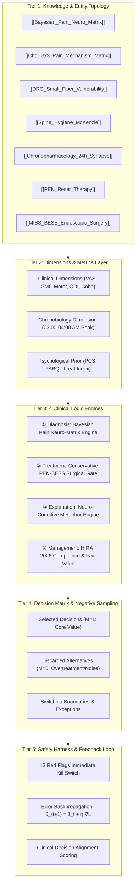

# 🏥 LUCA Clinical Deep Twin — Semantic Layer & LLM-Wiki Knowledge System
> **World-Class Spine Surgery & Mechanism-based Pain AI Deep Twin for Director Choi Sun Jong (MD, PhD)**  
> *Transforming Clinical Tacit Knowledge into Deterministic Semantic Layers and Cognitive Agent Architectures.*

[](LICENSE)
[]()
[-red.svg)]()
[]()

---

## 🌟 Overview (개요)

**LUCA Clinical Deep Twin**은 남양주백병원(NDB) 병원장이자 척추외과 세부전문의인 **최선종 박사(Sun Jong Choi, MD, PhD)**의 30여 년 임상 암묵지(Tacit Knowledge)를 완벽히 모델링하여, **ChatGPT Custom GPTs, Dots, Claude Project, Antigravity Agent**에 1:1 진료 특화 에이전트로 탑재할 수 있도록 설계된 **Semantic Layer 기반 지식 인프라**입니다.

기존의 단순 RAG(문서 검색) 방식이 가진 한계를 극복하기 위해, **Semantic Layer(5-Tier 시맨틱 레이어)**와 **Andrej Karpathy 스타일의 [[LLM-Wiki]] 지식 토폴로지**를 결합하여, LLM이 **"무엇을 보고 ➔ 어떤 대안을 비교하며 ➔ 왜 결정하고 ➔ 왜 버리며(Negative Sampling) ➔ 언제 판단을 바꾸는지"**를 0-환각(Zero-Hallucination)으로 재현합니다.

---

## 🏗️ 5-Tier Semantic Layer Architecture



---

## 🧠 Core Clinical Engines (4대 핵심 임상 엔진)

### 1. 진단 모델 (Diagnosis Model)
- **데카르트 전선 모델 탈피**: 통증을 자극의 수동적 전달이 아닌 **뇌의 능동적 베이즈 추론($\text{Posterior} \propto \text{Likelihood} \times \text{Prior}$)**으로 파악.
- **최선종 3×3 통증 기전 매트릭스**: 원인 해부학(척추/관절/혈관) × 통증 기전(침해수용성/신경병성/노시플라스틱) 9격자 감별.
- **신경인성 파행 vs 혈관성 파행 감별**: 보행 파행 시 신전/굴곡 변동 및 족배동맥 맥박 상태로 정밀 구분.

### 2. 수술계획·치료 모델 (Surgical Planning & Treatment Model)
- **3단계 치료 사다리 (The Treatment Ladder)**:
  1. **보존적 치료**: 척추 위생(굴곡 회피 + 맥켄지 신전 회복) + 시간약리학(새벽 3~4시 통증 피크 타깃 저녁 Duloxetine 복용).
  2. **중재적 시술**: PEN 경피적 경막외 신경성형술(유착 박리 + 염증 수프 세척 + 국소 화학적 리셋).
  3. **최소침습 수술**: BESS 양방향 척추내시경 감압술 (정상 구조 100% 보존).
- **수술 배제 필터 ($M=0$)**: 신경학적 마비가 없고 통증만 있는 급성 디스크 파열 환자는 80% 자연흡수(대식세포)를 유도하며 불필요한 나사못 유합술을 엄격히 배제.

### 3. 환자 설명 모델 (Patient Communication Model)
- **공포(Prior) 소거 3대 비유**:
  - **3대 화재경보기 비유**: 침해수용성(정상 경보), 신경병성(전선 합선), 노시플라스틱(센서 오작동).
  - **상처 반창고 비유**: 허리를 숙이는 동작은 갓 아물려는 디스크 상처를 매일 아침 손으로 뜯어내는 행위.
  - **신경성형술 청소 비유**: 하수구 찌꺼기를 호스로 씻어내듯 유착과 염증을 씻어내는 신경 대청소.

### 4. 병원경영·심사 모델 (Hospital Management & HIRA Compliance)
- **2026 심평원 척추수술 급여기준(자46)** 및 신경차단술 횟수/간격 기준 100% 준수 (삭감 제로).
- **합리적 비급여 3층 구조**: 필수 급여 ➔ 중재적 신의료기술(PEN/내시경) ➔ 재생/기능회복.

---

## 🚨 Tier 5: 13대 Red Flag 긴급 킬스위치

| # | 긴급 의심 징후 (Red Flag) | 의심 질환 | 즉시 행동 지침 |
| :-: | :--- | :--- | :--- |
| **1** | NEWS2 ≥ 5 또는 간호사의 악화 직관 | 급성 전신 악화 | 즉시 의사 평가 및 RRS 가동 |
| **2** | 수술 후 급성 근력 저하(SMC 마비) / 감각 저하 | 경막외 혈종 (Hematoma) | 집도의 호출, 응급 MRI, 6시간 내 재수술 |
| **3** | 경추 수술 후 호흡곤란 · 연하곤란 · 목 부종 | 기도 폐쇄 (Airway) | 침상에서 즉시 상처 봉합사 발사 및 개방 |
| **4** | 배뇨·배변 장애 + 안장부 감각 저하 | 마미총 증후군 (Cauda Equina) | 응급 MRI 및 24시간 내 긴급 감압술 |
| **5** | 한쪽 다리 급성 부종 / 돌발 호흡곤란·빈맥 | DVT / 폐색전증 (PE) | 혈관 초음파, 흉부 CT, 항응고 요법 |
| **6** | 흉통, 식은땀, 좌측 팔 방사통 | 급성 관상동맥 증후군 (ACS) | 10분 내 심전도(ECG), 트로포닌, 순환기내과 |
| **7** | 저혈압(SBP < 90) + 빈맥 + 의식변화 + 발열 | 패혈성 쇼크 (Septic Shock) | 1시간 내 혈액배양, 항생제, 수액, NE |
| **8** | 주사/약물 후 두드러기 + 호흡곤란 | 아나필락시스 (Anaphylaxis) | 에피네프린 0.5mg 외측 대퇴부 즉시 IM |
| **9** | BE-FAST 양성 (안면마비, 팔 위약 등) | 급성 뇌졸중 (Stroke) | LKW 확인, 뇌 CT, 뇌졸중센터 즉시 전원 |

---

## 📂 Repository Structure (저장소 구조)

```
luca-clinical-deep-twin/
├── README.md                                          # 마스터 아키텍처 및 설명서 (본 문서)
├── knowledge/
│   ├── LUCA_Clinical_Deep_Twin_Master_Semantic_Layer.md # 전체 완전체 마스터 학습자료 (31KB)
│   └── LUCA_Clinical_Deep_Twin_Master_Semantic_Layer.txt # 호환용 텍스트 파일
├── prompts/
│   └── system_prompt_chatgpt_dots.md                 # ChatGPT / Dots 전용 시스템 프롬프트
├── semantic_layer/
│   └── metrics_and_dimensions.yaml                   # 시맨틱 차원 및 수술 결정 규칙 명세
└── wiki/
    ├── 01_Bayesian_Pain_Neuro_Matrix.md              # 베이즈 통증 뉴로매트릭스 위키 노드
    ├── 02_Choi_3x3_Pain_Mechanism_Matrix.md          # 3x3 통증 기전 매트릭스 위키 노드
    ├── 03_Spine_Hygiene_and_PEN_Reset.md             # 척추 위생, PEN 세척, 시간약리학 위키 노드
    └── 04_Red_Flags_13_Emergency_Harness.md          # 13대 Red Flag 안전 하네스 위키 노드
```

---

## 🚀 How to Use (적용 가이드)

### 1. ChatGPT Custom GPTs / Dots
1. **Instructions (지침)**: [`prompts/system_prompt_chatgpt_dots.md`](prompts/system_prompt_chatgpt_dots.md)의 내용을 복사하여 붙여넣습니다.
2. **Knowledge (파일 업로드)**: [`knowledge/LUCA_Clinical_Deep_Twin_Master_Semantic_Layer.md`](knowledge/LUCA_Clinical_Deep_Twin_Master_Semantic_Layer.md) 파일을 그대로 업로드합니다.

### 2. Claude Project
- Project Knowledge에 `knowledge/` 및 `wiki/` 폴더 내 마크다운 파일들을 업로드하고, Custom Instructions에 시스템 프롬프트를 지정합니다.

---

## 📄 License & Attribution

- **Copyright (c) 2026 Sun Jong Choi, MD, PhD. Namyangju Baek Hospital (NDB).**
- All clinical protocols and pain matrix theories are proprietary tacit knowledge of Director Sun Jong Choi.
- Released under the [MIT License](LICENSE).
